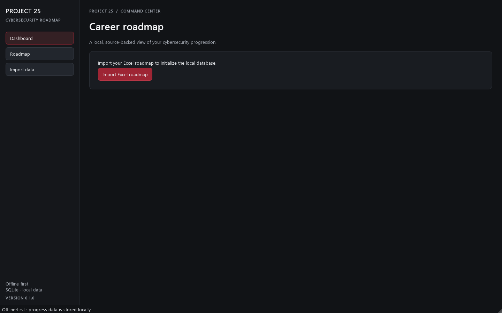
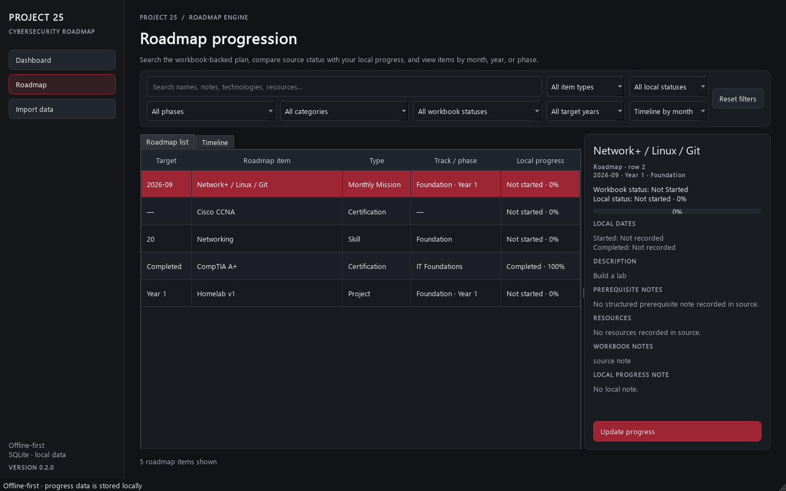
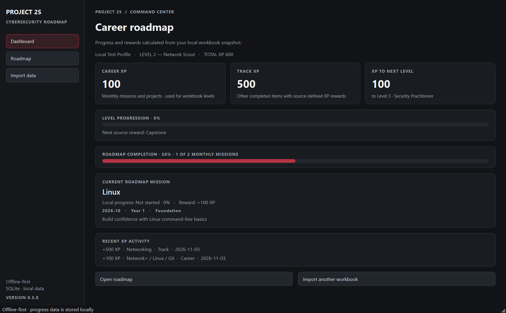

# Cybersecurity Career Roadmap

An offline-first Windows desktop application that turns the cybersecurity career workbook into a searchable, trackable, gamified roadmap. The project is developed in reviewable releases. **v0.3.0 adds workbook-backed XP rewards and career levels.**

The source workbook remains authoritative. The importer stores the source sheets, populated cells, formulas, saved formula values, and source coordinates in SQLite. It also creates normalized records for task-like rows so later releases can add progression features without losing workbook context. The original workbook is opened read-only and is never saved by the application.

## v0.3.0 features

- Browse all normalized missions, skills, certifications, projects, and learning objectives in one roadmap.
- Search workbook-backed names, descriptions, categories, phases, notes, resources, and source details.
- Filter by item type, category, phase, local progress status, original workbook status, and target year.
- Switch the timeline grouping between month, year, phase, and source sheet order.
- Track local status, progress percentage, dates, and notes without changing imported workbook values.
- View source status and locally tracked status side by side; reset a local override to the source-derived state.
- Earn source-defined XP when a roadmap item is completed; refreshes do not duplicate rewards, and a reset or reopened item creates a visible reversal.
- Calculate Career XP and levels from the workbook's own Dashboard level table and level rewards.
- Keep other workbook-defined rewards as Track XP, separate from Career XP, so they do not change the workbook's career level thresholds.
- Review current level, total/Career/Track XP, XP to next level, next source reward, monthly mission completion, and recent XP transactions on the dashboard.
- Inspect each roadmap item's source reward and currently awarded balance.
- Import `.xlsx` and `.xlsm` workbooks into versioned SQLite storage that preserves source values, formulas, cached values, validation ranges, chart references, and cell coordinates.

Career XP includes monthly missions and all normalized project rows. The workbook's Dashboard formula currently refers to Projects rows 2–12, while the Projects sheet contains additional records through row 18; the importer reports that source inconsistency. This release includes all imported project rewards so records are not silently left out. The source formula itself remains preserved unchanged.

Quests, skill trees, achievements, analytics, backup/restore, and Excel export are tracked in [ROADMAP.md](ROADMAP.md) for later releases.

## Screenshot

The first image shows the data-free first-run screen. The roadmap screenshot uses synthetic test data. The app reads the workbook without modifying it and keeps imported progress data in the user's local SQLite database.







## Installation

Python 3.11 or newer is recommended on Windows 10/11.

```powershell
git clone https://github.com/ZeroTrace-LPT/gamified-roadmap.git
cd gamified-roadmap
python -m venv .venv
.\.venv\Scripts\Activate.ps1
python -m pip install -r requirements.txt
python -m app.main
```

On first launch, choose **Import Excel workbook…** and select the roadmap file. The app writes a private SQLite database under `%LOCALAPPDATA%\CybersecurityRoadmap\roadmap.sqlite3`. Set `CYBER_ROADMAP_HOME` to use a different local data directory. The application does not need an account or network access after dependencies are installed.

To import from the command line:

```powershell
python -m app.importers.cli "C:\path\to\Cybersecurity_Roadmap.xlsx"
```

An explicit database can be selected with `--database`. Import findings are also saved in SQLite and shown in the Import data page.

## Build a Windows executable

```powershell
.\scripts\build_windows.ps1
```

The script creates a PyInstaller onedir build at `dist\CybersecurityRoadmap\`. It excludes optional image, accelerated XML, and numerical libraries that this app does not use. A one-file release build and fresh-machine installation checks are planned for the release-candidate stage.

## Development

```powershell
python -m unittest discover -s tests -v
```

The importer, database, progression, and XP service modules can be tested without starting Qt. The desktop interface requires PySide6.

## Architecture

```text
app/
  config/       Local application paths
  database/     SQLite schema and migrations
  gamification/ Workbook-derived level and XP calculations
  importers/    Excel parsing and validation
  models/       Typed domain records
  services/     Database-backed application queries
  ui/           PySide6 shell, theme, pages, and progress dialogs
tests/          Importer and persistence tests
scripts/        Windows packaging helpers
```

The SQLite database is local user data. Do not commit it, credentials, lab secrets, or portfolio evidence. `.gitignore` excludes SQLite files and local Excel workbooks by default.

## Contribution

See [CONTRIBUTING.md](CONTRIBUTING.md) for development conventions. The project uses semantic versioning and conventional commit messages. Feature work pauses at each documented review gate before the next planned release begins.

## License

MIT. See [LICENSE](LICENSE).
